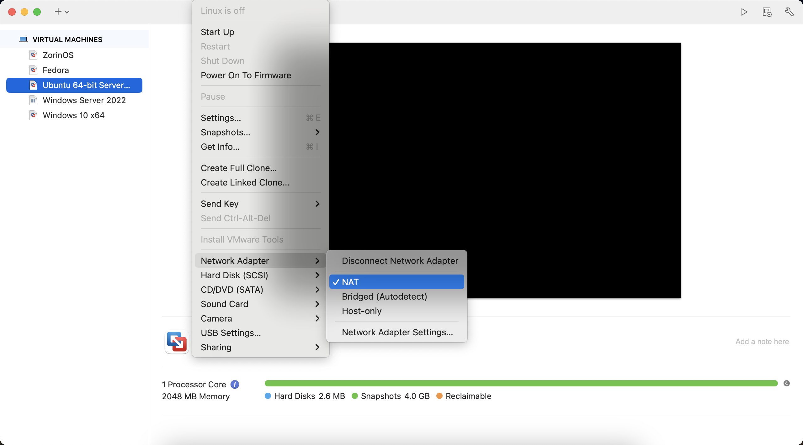
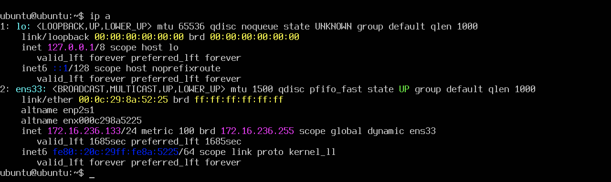
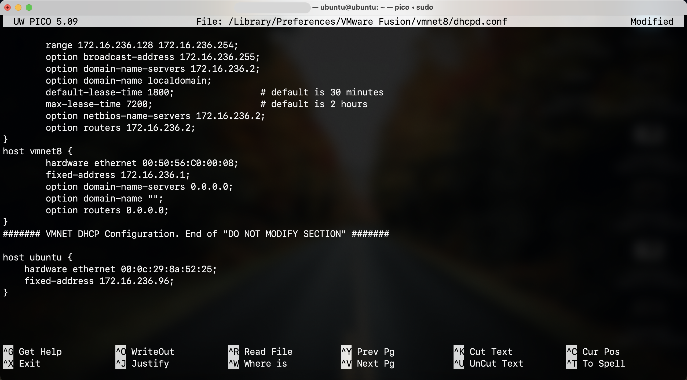
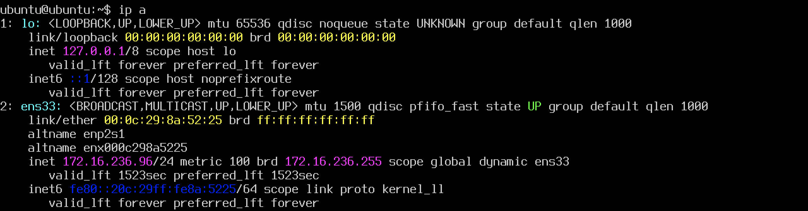

# VMware Fusion: Static DHCP configuration for VMware Fusion NAT (`vmnet8`)

This quick guide is for binding a permanent static IP to the virtual machine's MAC address using VMware's built-in DHCP server (`vmnet8`); no physical router access required. I used macOS as host OS and Ubuntu Server as a VM - though any other Linux-based VM will work exactly the same.

| Setting | Value |
| --- | --- |
| Host OS | macOS running VMware Fusion |
| Guest OS | Ubuntu Server 26.04 LTS |
| Network Mode | NAT (`vmnet8`) |

To access the Ubuntu VM via SSH the Bash command is `ssh ubuntu@<example_IP>`. In order to avoid typing out the IP portion every time, it's possible to edit the `.ssh/config` file to include a host alias:

   ```sh
   Host ubuntu
      HostName 172.16.236.133
      User ubuntu
      IdentityFile ~/.ssh/<key_name>
   ```

This way, typing `ssh ubuntu` is enough. However, at some point the VM will get a new IP address by default because VMware's default DHCP lease expires and assigns a fresh random address from its dynamic pool. Hence, `ssh ubuntu` will throw an error because the alias is no longer bound to the correct IP.

---

### Change Network Adapter and find the VM's MAC address
1. Launch VMware Fusion and the Ubuntu Server VM
2. Change the Network Adapter: `Virtual Machine` → `Network Adapter` → select `NAT`

<p align="center">
  
</p>

3. Log into the Ubuntu VM console and retrieve the  active network interface details by running `ip a`
4. Locate the active interface (e.g. `ens33`) and copy the MAC address listed next to `link/ether` (e.g.`00:0c:29:8a:52:25`)

<p align="center">
  
</p>

### Edit VMware's DHCP configuration
1. Fully quit VMware Fusion
2. On the CLI on the host OS, open the `vmnet8` DHCP file:

   ```sh
   sudo nano "/Library/Preferences/VMware Fusion/vmnet8/dhcpd.conf"
   ```

3. Scroll to the bottom, choose a new IP address and append the host block **below** the warning section. 
This hardcodes both the MAC and the IP addresses onto VMware's configuration.
   > VMware's dynamic pool operates between `.128` and `.254`. Choose a static address in the safe zone (`.2` to `.127`). **Never use `.1`**, as it is reserved for the virtual router/gateway exit interface.

<p align="center">
  
</p>

4. Save and exit

### Apply and verify
1. Re-open VMware Fusion and boot the Ubuntu Server VM
2. Run `ip a` once more to verify that the interface automatically gets a new DHCP lease and holds the reserved IP address

<p align="center">
  
</p>
   
3. Update SSH configuration file on the host OS (`~/.ssh/config`):

   ```sh
   Host ubuntu
      HostName 172.16.236.96  <-------------------  (New static IP address)
      User ubuntu
      IdentityFile ~/.ssh/<key_name>
   ```

   > It's a good idea to run `ssh-keygen -R <old-ip>` to clear old entries in `.ssh/known_hosts`
4. SSH into Ubuntu via the `ssh ubuntu` shortcut. Confirm when prompted for a new key
